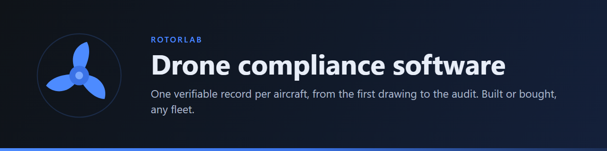
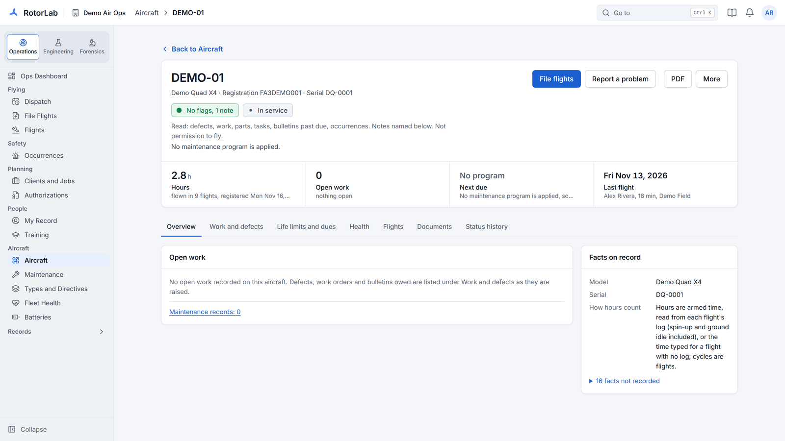
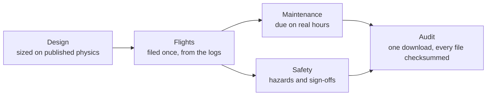
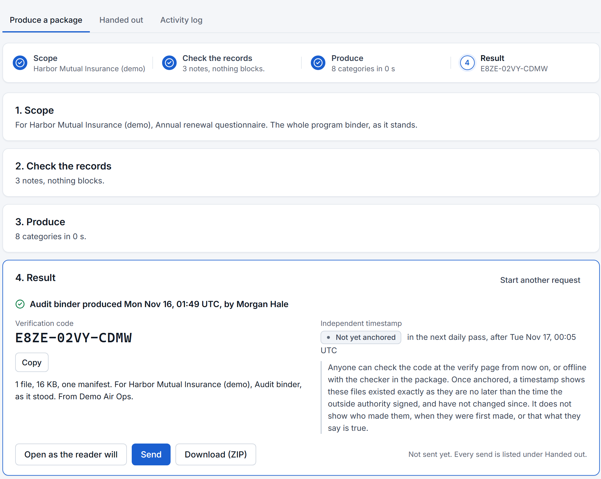

  

<h1 align="center">RotorLab: drone compliance software and the system of record for commercial drone programs</h1>

<b>One verifiable record per aircraft, from the first drawing to the audit.</b> 
Design, flight logs, maintenance and compliance records in one place, built from the logs your aircraft already write. 
Built your own or bought off the shelf: register the aircraft and the record starts there.

  <a href="https://rotorlab.app/pricing"><b>Start a 14-day trial, no card</b></a> ·
  <a href="https://rotorlab.app/contact-sales"><b>Talk to sales</b></a>

  <a href="https://rotorlab.app/">Website</a> ·
  <a href="https://docs.rotorlab.app/">Docs</a> ·
  <a href="https://rotorlab.app/developers">API</a> ·
  <a href="https://rotorlab.app/trust">Trust Center</a> ·
  <a href="https://academy.rotorlab.app/">Academy</a> ·
  <a href="https://rotorlab.app/changelog">Release notes</a>

  
  
  

<b>A code on every document</b>, anyone can check it · <b>2,440 public flight logs read</b>, every result published · <b>11 jurisdictions</b>, each in its own terms

---

## Drone compliance records, from design to audit

RotorLab keeps the whole life of each aircraft in one record: how it was designed, every flight it flew, every inspection, repair and part change, every hazard and sign-off. File the flight and the records keep themselves. When a regulator, an insurer or a customer asks what happened, you answer with one download. Every document RotorLab issues carries a code anyone can check at [rotorlab.app/verify](https://rotorlab.app/verify), every file in an audit binder has its own SHA-256 checksum, and records are timestamped daily by independent services.

  <picture>
    <source media="(prefers-color-scheme: dark)" srcset="https://raw.githubusercontent.com/RotorLabApp/.github/main/profile/rotorlab-aircraft-record-dark.png">
  
  </picture>
   One aircraft's record, from a demo organization. It says what the records show, and that this is not permission to fly.

**Guidance, never authorization.** RotorLab records, reminds and warns. It never approves or clears a flight, and it is not affiliated with any regulator. Every approval stays with the people and the authorities who give it, and RotorLab records it as theirs.

**Evaluating RotorLab?** Read the [open-source ground station code](https://github.com/RotorLabApp/RotorLabGC), the [developer API and OpenAPI spec](https://rotorlab.app/developers) and the [Trust Center](https://rotorlab.app/trust).

**Engineering?** Start with the [API examples](https://github.com/RotorLabApp/rotorlab-api-examples), the [relay agent](https://github.com/RotorLabApp/rotorlab-relay-agent) for live telemetry, the [import templates](https://github.com/RotorLabApp/rotorlab-import-templates) for moving your records in, or the [design math](https://github.com/RotorLabApp/rotorlab-design-math) behind the Builder.

## Works with the aircraft you fly

| Area | What RotorLab works with |
|---|---|
| **Flight logs** | ArduPilot and PX4, DJI flight records (encrypted ones too, when your organization switches DJI reading on), Parrot, Betaflight and INAV Blackbox, GUTMA, Litchi, Airdata and CSV. |
| **Maintenance programs** | Programs for the DJI Matrice 350, Skydio X10 and Autel EVO Max start from their makers' published maintenance schedules; every other airframe starts from conservative practice. |
| **Live telemetry** | MAVLink aircraft through RotorLab GC or the Fleet Server, and any aircraft through RotorLab telemetry. |
| **Aircraft you build** | Size a multirotor, VTOL or fixed wing on published physics, and the design becomes the first page of its record. |

## Who RotorLab is for

| Who | What they get |
|---|---|
| **[Fleet operators](https://rotorlab.app/for/operators)** | Component life, battery horizon, recurrency and filing deadlines, counted from real flights. Advisory, never gating. |
| **[Public safety](https://rotorlab.app/for/public-safety)** | File the flight once with its call, position and outcome; the transparency page and records-request package read from it. |
| **[Drone manufacturers](https://rotorlab.app/for/manufacturers)** | Size the aircraft on published physics, freeze the type, and hand buyers a verifiable dossier. |
| **[Film and custom rigs](https://rotorlab.app/for/film)** | Document a custom camera rig the way a manufacturer would, with measured performance and a checkable dossier. |
| **[Education](https://rotorlab.app/education)** | Teach aeronautical engineering on an engine students can see through, tested on a real aircraft. |

## The platform: flight records, maintenance, safety and audit

- **[Design](https://rotorlab.app/platform/design):** size the aircraft on published physics, check balance and radio range, then calibrate from its own hover.
- **[Flight records](https://rotorlab.app/platform/flight-records):** file a day of flight logs at once; every flight lands once on the aircraft that flew it.
- **[Fleet health](https://rotorlab.app/platform/fleet-health):** vibration, battery sag and motor balance trended per airframe, with the flights behind every flag.
- **[Maintenance](https://rotorlab.app/platform/maintenance):** programs, work orders, defects, deferrals and life-limited parts, due on real hours and signed in a numbered tech log.
- **[Safety management](https://rotorlab.app/platform/safety):** a hazard register scored before and after mitigation, with named risk acceptance.
- **[Operations manual](https://rotorlab.app/platform/ops-manual):** build an operations manual from outlines for 11 jurisdictions, with signed, frozen revisions.
- **[Audit and evidence](https://rotorlab.app/platform/audit):** answer a records request in one download, section by section.
- **[Part 107 recordkeeping](https://rotorlab.app/part-107-records):** what a Part 107 operator keeps and produces on request.

## Products

| Product | What it is |
|---|---|
| **[RotorLab](https://rotorlab.app/)** | The platform, hosted for you in the United States. Sign in with your own identity provider, and export your records as JSON and CSV at any time. |
| **[RotorLab GC](https://rotorlab.app/gc)** | A full MAVLink ground control station for multirotor, VTOL, fixed wing and quadplane on Windows and Android, with first-class ATAK integration. Free with a RotorLab account for one station; talk to us about a fleet. Open source. |
| **[Log Analyzer](https://app.rotorlab.app/logs)** | Read ArduPilot, PX4, Betaflight, INAV, DJI, Parrot and CSV flight logs free in your browser. |
| **[Security Analyzer](https://rotorlab.app/security-analyzer)** | Assess your fleet against UASVS, an open, vendor-neutral standard, using the flight logs you already store. |
| **[Developer API](https://rotorlab.app/developers)** | REST API for performance analysis, center of gravity, RF link budgets and log forensics, with an OpenAPI spec. |
| **[RotorLab Academy](https://academy.rotorlab.app/)** | Training, with certificates of completion, for pilots and teams. |
| **[RotorLab Server](https://rotorlab.app/fleet-server)** | Fleet Server in the field and Records Server in the records office, on your own network. In early access testing, not on sale today. |

Government programs that need RotorLab on their own network: RotorLab Server is in early access testing and not on sale today. [Talk to us](https://rotorlab.app/contact-sales).

## Open source at RotorLab

We publish the software that runs in the field so the people who rely on it can read it.

**Run it in the field**

| Project | What it is |
|---|---|
| **[RotorLabGC](https://github.com/RotorLabApp/RotorLabGC)** | RotorLab GC's full source, built on [QGroundControl](https://qgroundcontrol.com/). Your security team can review the source of what runs on your field laptops and tablets, and build it yourself. Source under Apache 2.0 or GPL v3, at your choice; published builds under GPL v3. |
| **[rotorlab-gc-tak-guide](https://github.com/RotorLabApp/rotorlab-gc-tak-guide)** | The field guide to RotorLab GC with ATAK and TAK: connecting to a TAK server, putting aircraft on the TAK map, and deciding which ATAK commands the station acts on, with screenshots of a conservative setup and a one-page quick reference. CC BY 4.0. |
| **[rotorlab-relay-agent](https://github.com/RotorLabApp/rotorlab-relay-agent)** | The live telemetry relay agent: one Python file that sends an ArduPilot or PX4 aircraft's MAVLink stream to the RotorLab Live Telemetry page over outbound WSS. View-only, standard library, no inbound port. Apache 2.0. |
| **[rotorlab-relay-pi](https://github.com/RotorLabApp/rotorlab-relay-pi)** | One-script Raspberry Pi setup: mavlink-router plus the relay agent as hardened services, for live telemetry from the field. View-only. Apache 2.0. |

**Build with it**

| Project | What it is |
|---|---|
| **[rotorlab-api-examples](https://github.com/RotorLabApp/rotorlab-api-examples)** | The developer kit: Python and curl examples for the RotorLab API, a signed-webhook receiver, MCP setup, and the published OpenAPI spec and Postman collection. Apache 2.0. |
| **[rotorlab-import-templates](https://github.com/RotorLabApp/rotorlab-import-templates)** | The switch-over kit: CSV templates for RotorLab's importers and checkers that refuse bad rows before you upload. Apache 2.0. |

**Learn from it**

| Project | What it is |
|---|---|
| **[rotorlab-design-math](https://github.com/RotorLabApp/rotorlab-design-math)** | The published physics behind the Builder (hover, propulsion, fixed wing, balance, link budget) as readable Python with worked examples, for engineers and educators. Apache 2.0. |

GC speaks standard MAVLink and is built for ArduPilot and PX4 aircraft. Running GC takes a license key from your RotorLab account, free for one station. We keep QGroundControl's license and credit its contributors and the Dronecode community. QGroundControl, Dronecode, MAVLink, ArduPilot, PX4, ATAK, TAK, DJI, Matrice, Skydio, X10, Autel, EVO, Parrot, Betaflight, INAV, GUTMA, Litchi, Airdata, Raspberry Pi, Postman, OpenAPI, Windows and Android are trademarks of their respective owners. RotorLab names them only to say what it works with, and is not affiliated with or endorsed by any of their owners, the TAK Product Center or the U.S. Government.

## Trust and security

  <picture>
    <source media="(prefers-color-scheme: dark)" srcset="https://raw.githubusercontent.com/RotorLabApp/.github/main/profile/rotorlab-audit-binder-dark.png">
  
  </picture>
   An audit binder for a demo insurer: one download, a code anyone can check, and an independent timestamp added in the next daily pass.

Single sign-on, two-factor sign-in, verifiable documents, independent timestamps and export at any time. The [Trust Center](https://rotorlab.app/trust) says what we do and what we do not claim. Public bodies: see the [government terms](https://rotorlab.app/government).

Report a security issue to **security@rotorlab.app**, or privately through GitHub security advisories on the repository concerned (each repository's **Security** tab, **Report a vulnerability**). Please do not open a public issue for a security problem.

## About RotorLab

RotorLab, Inc. was founded and builds in Dubuque, Iowa. We work with the [Loras College](https://rotorlab.app/partners) engineering program and [Snap Manufacturing](https://rotorlab.app/partners), and field Iowa's MultiGP chapter. [About us](https://rotorlab.app/about) · [Partners](https://rotorlab.app/partners) · [Events](https://rotorlab.app/events)

**Stay current:** [release notes](https://rotorlab.app/changelog), [Insights](https://rotorlab.app/insights/) and the [newsletter](https://rotorlab.app/newsletter).

**Contact:** [sales](https://rotorlab.app/contact-sales) · [support](https://rotorlab.app/contact) · press: **media@rotorlab.app** · general: **info@rotorlab.app** · [service status](https://app.rotorlab.app/status)

---

  <a href="https://rotorlab.app/">RotorLab</a> ·
  <a href="https://docs.rotorlab.app/">Docs</a> ·
  <a href="https://rotorlab.app/contact">Support</a> ·
  <a href="https://rotorlab.app/trust">Trust Center</a> ·
  <a href="https://rotorlab.app/contact-sales">Talk to sales</a>

RotorLab, Inc., Dubuque, Iowa. RotorLab records and warns; it never authorizes a flight.

